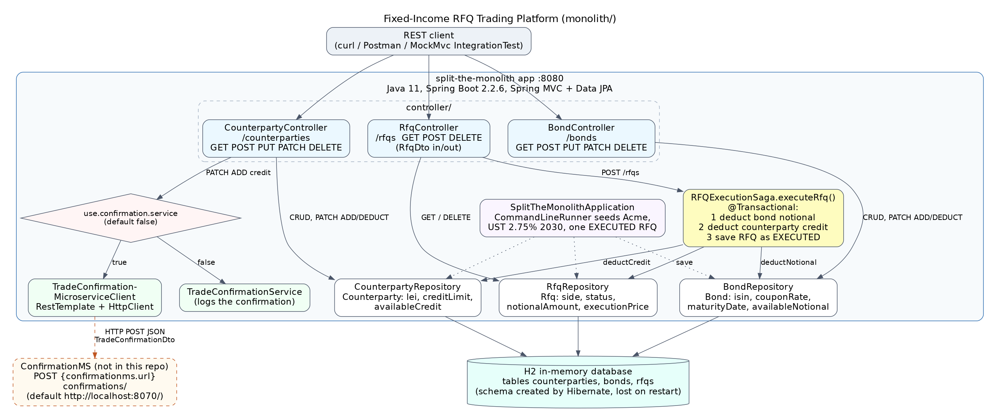

# Fixed-Income RFQ Trading Platform

A SpringBoot monolith simulating a **fixed-income Request-for-Quote (RFQ) trading platform**.

Technologies used:
 - Java 11, Spring Boot, Spring Data JPA
 - H2 in-memory database
 - Maven

- [Fixed-Income RFQ Trading Platform](#fixed-income-rfq-trading-platform)
  - [Architecture](#architecture)
  - [Project Layout](#project-layout)
  - [Domain Entities](#domain-entities)
  - [REST Endpoints](#rest-endpoints)
  - [Seed Data](#seed-data)
  - [Running the Application](#running-the-application)
  - [Configuration](#configuration)
  - [Testing](#testing)

## Architecture

See [docs/architecture.md](docs/architecture.md) for the components, data model, request flows and configuration.



## Project Layout

```
monolith/                       Spring Boot application (the only module)
  pom.xml                       Maven build (Spring Boot 2.2.6, Java 11)
  mvnw, .mvn/                   Maven wrapper
  src/main/java/com/javieraviles/splitthemonolith/
    controller/                 REST controllers for counterparties, bonds, RFQs
    saga/                       RFQExecutionSaga (transactional RFQ execution)
    entity/                     JPA entities and enums
    repository/                 Spring Data JPA repositories
    dto/                        RfqDto, TradeConfirmationDto, OperationEnum
    service/, restclient/       Trade confirmation (log or external HTTP service)
    exception/                  404 / 400 exceptions
  src/main/resources/application.properties
  src/test/java/.../IntegrationTest.java
docs/
  architecture.md               Architecture overview
  diagrams/                     Graphviz source, render script, PNG/SVG
```

## Domain Entities

Three domain entities:
 - **Counterparty**
   - name
   - lei (Legal Entity Identifier)
   - creditLimit (BigDecimal)
   - availableCredit (BigDecimal)
 - **Bond**
   - isin (unique, e.g. US912828YK15)
   - issuer
   - couponRate (BigDecimal)
   - maturityDate (LocalDate)
   - availableNotional (BigDecimal — par amount available for trading)
 - **RFQ** (Request for Quote)
   - counterparty (manyToOne)
   - bond (manyToOne)
   - notionalAmount (BigDecimal — par amount requested)
   - side (BUY / SELL)
   - status (PENDING / QUOTED / EXECUTED / REJECTED)
   - executionPrice (BigDecimal — total settlement amount)
   - createdAt (Instant)

Counterparty and Bond must be in place before executing an RFQ. If the bond has insufficient available notional or the counterparty has insufficient available credit, an exception will be thrown. The core logic is in `RFQExecutionSaga.java`, which attempts to execute an RFQ in a single transaction.

A PATCH method endpoint exists for both `Counterparty` and `Bond` controllers to update credit / notional inventory.

Whenever credit is added to a counterparty, a trade confirmation is produced. By default `TradeConfirmationService.java` only logs it; with `use.confirmation.service=true` it is POSTed to an external confirmation service instead (see [Configuration](#configuration)).

## REST Endpoints

| Method | Path                   | Description                                      |
|--------|------------------------|--------------------------------------------------|
| GET    | `/counterparties`      | List all counterparties                          |
| POST   | `/counterparties`      | Create a counterparty                            |
| GET    | `/counterparties/{id}` | Get a counterparty by ID                         |
| PUT    | `/counterparties/{id}` | Update a counterparty                            |
| PATCH  | `/counterparties/{id}` | Add or deduct credit (JSON: `amount`, `operation`) |
| DELETE | `/counterparties/{id}` | Delete a counterparty                            |
| GET    | `/bonds`               | List all bonds                                   |
| POST   | `/bonds`               | Create a bond                                    |
| GET    | `/bonds/{id}`          | Get a bond by ID                                 |
| PUT    | `/bonds/{id}`          | Update a bond                                    |
| PATCH  | `/bonds/{id}`          | Add or deduct notional (JSON: `amount`, `operation`) |
| DELETE | `/bonds/{id}`          | Delete a bond                                    |
| GET    | `/rfqs`                | List all RFQs                                    |
| POST   | `/rfqs`                | Execute an RFQ                                   |
| GET    | `/rfqs/{id}`           | Get an RFQ by ID                                 |
| DELETE | `/rfqs/{id}`           | Delete an RFQ                                    |

## Seed Data

On startup the application loads:
- **Counterparty**: Acme Asset Management (LEI: 549300EXAMPLE12345678, credit limit: $50,000,000)
- **Bond**: US Treasury 2.75% 11/15/2030 (ISIN: US912828YK15, available notional: $100,000,000)
- **RFQ**: BUY $5,000,000 notional at $4,987,500 — status EXECUTED

All entities share one ID sequence, so on a fresh start the counterparty is `/counterparties/1`, the bond is `/bonds/2` and the RFQ is `/rfqs/3`. The seed RFQ is inserted directly and does not reduce the seeded credit or notional.

## Running the Application

Requires a JDK 11 or newer (the build targets Java 11; tests also pass on JDK 17). The Maven wrapper downloads Maven 3.6.3 on first use.

```bash
cd monolith
./mvnw spring-boot:run
```

The application starts on port `8080`. Hit `/counterparties`, `/bonds`, and `/rfqs` to verify the REST endpoints. Data lives in an in-memory H2 database and is reset on every restart; the H2 console is at `/h2-console`.

Example RFQ against the seed data:

```bash
curl -X POST localhost:8080/rfqs -H 'Content-Type: application/json' \
  -d '{"counterpartyId":1,"bondId":2,"notionalAmount":1000000,"side":"BUY","executionPrice":995000}'
```

## Configuration

Set in `monolith/src/main/resources/application.properties`:

| Property | Default | Effect |
|----------|---------|--------|
| `server.port` | `8080` | HTTP port |
| `use.confirmation.service` | `false` | When `true`, credit-added confirmations are POSTed to the external confirmation service instead of logged |
| `confirmationms.url` | `http://localhost:8070/` | Base URL of that service (not part of this repository) |

## Testing

```bash
cd monolith
./mvnw clean test
```

See `IntegrationTest.java` (7 tests) for the full set of use-cases covering RFQ execution, insufficient notional/credit, and missing counterparty/bond scenarios.
