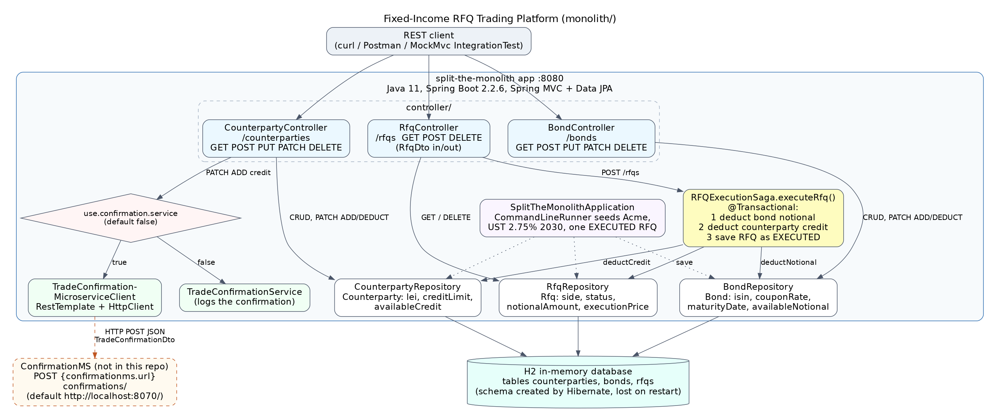

# Architecture

This page describes what the code on `master` does today: one Spring Boot application in `monolith/`, backed by an in-memory H2 database. There are no other services in the repository.

The diagram source is [`diagrams/architecture.dot`](diagrams/architecture.dot). After editing it, run `docs/diagrams/render.sh` (needs Graphviz: `sudo apt-get install -y graphviz`) and commit the regenerated `architecture.png` and `architecture.svg`.

## Runtime

| Piece | Details |
|-------|---------|
| Application | `SplitTheMonolithApplication` (`com.javieraviles.splitthemonolith`), Spring Boot 2.2.6, Java 11 target, port `8080` |
| Web layer | Spring MVC `@RestController`s, JSON in and out |
| Persistence | Spring Data JPA repositories over Hibernate; H2 in-memory database, schema created from the entities on startup and dropped on shutdown |
| Outbound HTTP | `RestTemplate` built on Apache HttpClient, used only when `use.confirmation.service=true` |
| Configuration | `monolith/src/main/resources/application.properties` |

## Packages

| Package | Contents |
|---------|----------|
| `controller` | `CounterpartyController` (`/counterparties`), `BondController` (`/bonds`), `RfqController` (`/rfqs`) |
| `saga` | `RFQExecutionSaga`: executes an RFQ in one database transaction |
| `entity` | `Counterparty`, `Bond`, `Rfq` JPA entities; `Side` (BUY, SELL) and `RfqStatus` (PENDING, QUOTED, EXECUTED, REJECTED) enums |
| `repository` | `CounterpartyRepository`, `BondRepository`, `RfqRepository` (plain `JpaRepository` interfaces) |
| `dto` | `RfqDto` (RFQ request/response, refers to counterparty and bond by id), `TradeConfirmationDto`, `OperationEnum` (ADD, DEDUCT) |
| `service` | `TradeConfirmationService`: logs a trade confirmation |
| `restclient` | `TradeConfirmationMicroserviceClient`: POSTs a trade confirmation to an external service |
| `exception` | `ResourceNotFoundException` (404), `InsufficientNotionalException` and `InsufficientCreditException` (400) |

## Data model

| Table (entity) | Columns | Notes |
|----------------|---------|-------|
| `counterparties` (`Counterparty`) | `id`, `name` (3-100 chars), `lei` (max 24), `credit_limit`, `available_credit` | `available_credit` defaults to `credit_limit` when a counterparty is created without it (`@PrePersist`) |
| `bonds` (`Bond`) | `id`, `isin` (unique, 12 chars), `issuer`, `coupon_rate` (7,4), `maturity_date`, `available_notional` | |
| `rfqs` (`Rfq`) | `id`, `counterparty_id`, `bond_id`, `notional_amount`, `side`, `status`, `execution_price`, `created_at` | many-to-one to both tables, eagerly fetched; `created_at` set on insert |

All three entities use `GenerationType.AUTO`, so they share one Hibernate sequence. On a fresh start the seeded counterparty is id `1`, the seeded bond id `2` and the seeded RFQ id `3`.

`Counterparty.deductCredit` and `Bond.deductNotional` throw `InsufficientCreditException` / `InsufficientNotionalException` when the amount is larger than what is available. The matching `add*` methods have no limit.

## Request flows

### Execute an RFQ (`POST /rfqs`)

1. `RfqController` receives an `RfqDto` (`counterpartyId`, `bondId`, `notionalAmount`, `side`, `executionPrice`) and calls `RFQExecutionSaga.executeRfq`.
2. Inside one `@Transactional` method the saga loads the bond and the counterparty (404 if either is missing).
3. It deducts `notionalAmount` from the bond's `availableNotional` (400 "Insufficient notional" if too large).
4. It deducts `executionPrice` from the counterparty's `availableCredit` (400 "Insufficient credit" if too large). Because both changes are in the same transaction, a failure here also rolls back the notional change.
5. It saves a new `Rfq` with status `EXECUTED` and returns it as an `RfqDto` with HTTP 201.

The caller supplies the price; nothing in the code quotes a price, and no code path sets `PENDING`, `QUOTED` or `REJECTED`.

### Adjust credit or notional (`PATCH /counterparties/{id}`, `PATCH /bonds/{id}`)

The body is `{"amount": "<decimal>", "operation": "ADD" | "DEDUCT"}`. An unknown `operation` returns 400 `wrong operation`. DEDUCT uses the same checks as RFQ execution.

When credit is **added** to a counterparty, the controller builds a `TradeConfirmationDto` (counterparty name, amount) and routes it on the `use.confirmation.service` flag:

| `use.confirmation.service` | What happens |
|----------------------------|--------------|
| `false` (default) | `TradeConfirmationService` writes an INFO log line: `Trade confirmation: counterparty <name> credit updated, amount <amount>` |
| `true` | `TradeConfirmationMicroserviceClient` POSTs the DTO as JSON to `${confirmationms.url}confirmations/` (default `http://localhost:8070/confirmations/`). That service is not in this repository; if nothing answers, the PATCH returns 500 and the credit change is not saved. |

### CRUD

`GET`, `POST`, `PUT` and `DELETE` on `/counterparties` and `/bonds` read and write the entities directly through their repositories. `/rfqs` has `GET` and `DELETE`; `POST` always goes through the saga. `PUT` replaces every field, including `availableCredit` / `availableNotional`.

## Startup seed data

`SplitTheMonolithApplication.run` (a `CommandLineRunner`) inserts:

- Counterparty Acme Asset Management, LEI `549300EXAMPLE12345678`, credit limit and available credit 50,000,000.00
- Bond `US912828YK15`, US Treasury, coupon 2.75%, maturing 2030-11-15, available notional 100,000,000.00
- RFQ: Acme BUY 5,000,000.00 of that bond at 4,987,500.00, status `EXECUTED`

The seed RFQ is saved directly, not through the saga, so it does not reduce the seeded credit or notional.

## Configuration

| Property | Default | Effect |
|----------|---------|--------|
| `server.port` | `8080` | HTTP port |
| `spring.jpa.open-in-view` | `false` | No open session during view rendering |
| `use.confirmation.service` | `false` | Route credit-added confirmations to the external service instead of the log |
| `confirmationms.url` | `http://localhost:8070/` | Base URL of the external confirmation service |

Any of these can be overridden on the command line, for example `./mvnw spring-boot:run -Dspring-boot.run.arguments="--use.confirmation.service=true"`.

`spring-boot-devtools` is a runtime dependency, so when the app runs from Maven the H2 console is available at `http://localhost:8080/h2-console`.

## Tests

`monolith/src/test/java/.../IntegrationTest.java` starts the full application context with MockMvc and the seed data, and covers listing counterparties and bonds, a successful RFQ, insufficient notional, insufficient credit, and a missing counterparty or bond (7 tests). Run them with `cd monolith && ./mvnw clean test`.

## Where this came from

The code started as Javier Aviles's 2020 "split the monolith" example (orders, customers and products, with a saga and a feature-toggled notifications microservice). In May 2026 it was reskinned as a fixed-income RFQ platform and cut down to the monolith only, which is why the package and artifact are still named `splitthemonolith`.
